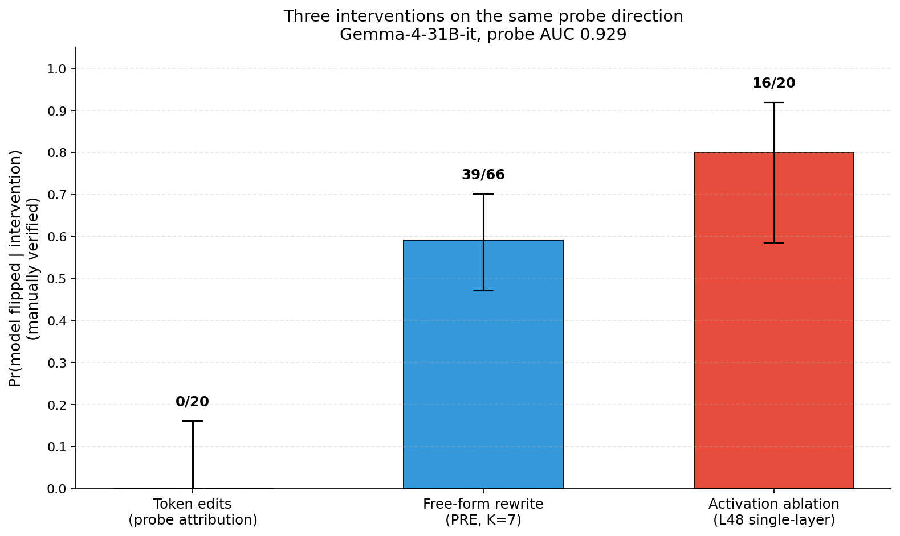

# Refusal probes: prediction is not causation

Probe the residual streams of **Gemma-4-31B-it and Qwen3.6-27B** to predict refusal and cyber-harm category, then intervene to test whether the decoded signal actually controls behavior.

**Recorded mean test AUC: 0.918 across five tasks.** The more interesting result is the gap between a useful predictor and a reliable causal intervention: minimal token edits failed, while targeted activation ablation changed behavior.

[Results notebook](RESULTS.ipynb) · [Full audited results](results_FINAL.md) · [Presentation](SLIDE_DECK_FINAL.md)

## Prediction results

| Task | Method | Test AUC |
|---|---|---:|
| Gemma refusal | Direction-only, layer 48 | 0.929 |
| Qwen refusal | XGBoost, layer 48 | 0.884 |
| Cyber: dual-use vs. benign | Hybrid features + XGBoost | 0.964 |
| Cyber: high-risk vs. lower-risk | Hybrid features + XGBoost | 0.935 |
| Cyber: prohibited vs. other categories | Hybrid features + XGBoost | 0.879 |

The hybrid representation combines direction loadings, logit-lens features, and derived features. Layer sweeps compare where the signal becomes predictive rather than assuming a middle layer is best.

## Causal tests and audited outcomes

| Intervention | Audited outcome | Reported Wilson 95% interval |
|---|---|---|
| Minimal token edits guided by attribution | 0/20 behavior flips | 0–16% |
| Free-form rewriting, seven candidates | 39/66 intent-preserved prompts produced genuine compliance | 47–70% |
| Refusal-direction ablation at layer 48 | 16/20 outputs showed genuine compliance | 57–93% |
| Random-direction ablation at layer 48 | 0/20 genuine compliances | 0–16% |

The rewrite run began with 81 prompts; 66 passed the intent-preservation gate. For the layer-48 experiment, the untreated baseline already complied on 1/20 prompts, so 16/20 is a compliance rate, not 16 verified refusal-to-compliance transitions.

Manual review mattered: the automated judge counted some soft refusals and corrupted outputs as compliance. The random-direction control produced apparent successes that disappeared under inspection.

## What we learned

A high-AUC direction is not automatically a robust monitor or an interpretable attribution map. In this experiment, changing the extraction method or layer changed the intervention outcome—even when probe accuracy remained similar. The targeted ablation provides evidence of a causal handle on this checkpoint; it does not establish one universal refusal direction or a deployable guardrail.

## Inspect and reproduce

The [results notebook](RESULTS.ipynb) and [audited report](results_FINAL.md) expose the measurements without requiring a model download. [Classifier analyses](notebooks/level1_classifiers.ipynb) and [intervention analyses](notebooks/level2_strategies.ipynb) document the two stages.

Full reruns require model weights, activation extracts, and the original compute/API environment. The [environment guide](docs/onboarding.md) and [original hackathon brief](HACKATHON.md) retain those setup details. The source entry points are [edit_agent.py](edit_agent.py), [pre_agent.py](pre_agent.py), and [patch_agent.py](patch_agent.py); cached outcomes are in [edit_eval/](edit_eval/).

Built by Veronika Wannack with teammate Federico Dejean. Hackathon-provided scaffolding and rules are distinguished from the team's experiments in the original brief and source layout.
